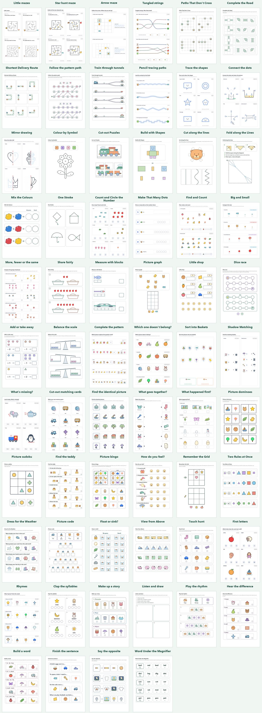

[Slovenčina](README.sk.md) · [English](../README.md) · [Čeština](README.cs.md) · [Deutsch](README.de.md) · [Polski](README.pl.md) 
[Magyar](README.hu.md) · [Français](README.fr.md) · [Español](README.es.md) · [Italiano](README.it.md) · [Português](README.pt.md) 
[Nederlands](README.nl.md) · [Română](README.ro.md) · [Українська](README.uk.md) · [Ελληνικά](README.el.md) · **Svenska** 
[简体中文](README.zh-Hans.md) · [繁體中文](README.zh-Hant.md) · [日本語](README.ja.md) · [한국어](README.ko.md) · [Bahasa Indonesia](README.id.md) 
[Türkçe](README.tr.md) · [Tiếng Việt](README.vi.md) · [Português (Brasil)](README.pt-BR.md)

<!--
SPDX-FileCopyrightText: 2026 Milan Jankovec
SPDX-License-Identifier: EUPL-1.2
-->

# little-explorers

little-explorers är en samling med öppen källkod som innehåller 64 utskrivbara spel och arbetsblad för barn mellan 3 och 5 år. Aktiviteterna är reklamfria och finns på 23 språk. Standardspråket är engelska.

**[Prova på GitHub Pages](https://milanjankovec.github.io/little-explorers/?lang=sv)**

## Välj, skapa och skriv ut

1. Välj en aktivitet och ett språk. Knapparna på sidan fungerar med mus och pekskärm.
2. Klicka på **Nya…** för att skapa ett nytt arbetsblad.
3. Välj **Skriv ut arbetsblad** eller **Skriv ut spelen**. Välj stående A4-format och skriv ut bladet eller spara det som en PDF. Barnen löser uppgifterna på papper.

## Aktiviteter

- **Labyrinter och stigar** — Små labyrinter · Stjärnjakt i labyrinten · Pillabyrint · Trassliga snören · Vägar som inte korsas · Gör vägen hel · Kortaste leveransvägen · Mönsterstigen · Tåget genom tunnlarna
- **Ritning och former** — Rita längs linjerna · Följ formernas konturer · Dra streck mellan prickarna · Spegelbilder · Färglägg efter symboler · Klipp och pussla · Bygg med former · Klipp längs linjerna · Vik längs linjerna · Blanda färgerna · Med ett enda streck
- **Räkning och storlekar** — Räkna och ringa in talet · Gör så många prickar · Hitta och räkna · Stort och litet · Fler, färre eller lika många · Dela rättvist · Mät med klossar · Bilddiagram · Lilla affären · Tärningsrace · Lägg till eller ta bort · Balansera vågen
- **Logik och uppmärksamhet** — Fyll i mönstret · Vilken passar inte in? · Sortera i korgar · Matcha skuggor · Vad saknas i bilden? · Memorykort att klippa ut · Hitta samma bild · Vad hör ihop? · Vad hände först? · Bilddomino · Bildsudoku · Hitta nallen · Bildbingo · Hur känner du dig? · Kom ihåg rutnätet · Två regler samtidigt · Klä dig efter vädret · Bildkod · Flyter eller sjunker? · Ovanifrån · Känn och hitta
- **Bokstäver och ord** — Första bokstaven · Rim · Klappa stavelserna · Hitta på en berättelse · Lyssna och rita · Spela rytmen · Hör skillnaden · Sätt ihop ordet · Avsluta meningen · Säg motsatsen · Ord under lupp

### Förhandsvisningar för utskrift

## Använd utan internet

Ladda ner och packa upp projektets ZIP-fil eller klona Git-repot. Öppna [index.html](../index.html) från mappen i en webbläsare. Varje aktivitet innehåller egen CSS, JavaScript och SVG-grafik. Du kan skapa och skriva ut arbetsblad utan att installera något eller starta en webbserver.

## Licens

Projektet omfattas av [Europeiska unionens offentliga licens v1.2 (EUPL-1.2)](../LICENSE). Om du sprider projektet eller en modifierad version, även genom att göra den tillgänglig på nätet, ska du behålla de obligatoriska licensmeddelandena och tillgängliggöra motsvarande källkod enligt licensvillkoren. Bestämmelserna om kompatibilitet finns i artikel 5.

© 2026 Milan Jankovec · [Källkod på GitHub](https://github.com/milanjankovec/little-explorers)
